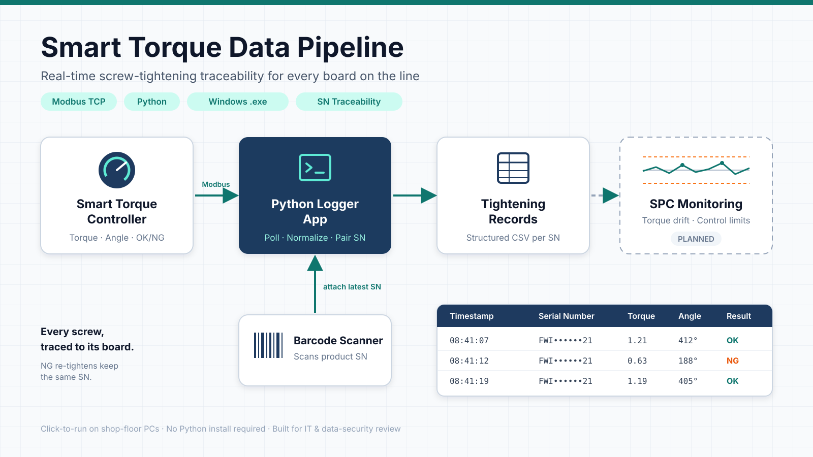

## 🔩 Smart Torque Data Pipeline: Real-Time Screw Station Data Collection
🔗 [GitHub Repo](https://github.com/oscar10408/smart-torque-logger) &nbsp;&nbsp;🏭 Industry Project @ Foxconn (FII USA)

**Description**  
A production data pipeline that captures every screw-tightening event from an industrial smart torque controller and links it to the product being assembled, which gives the factory a complete, traceable quality record for each board.  
It turns a vendor's raw Modbus client script into a click-to-run Windows application that runs on the shop floor without needing Python installed.

- Streams tightening records (torque, angle, result, timestamps) continuously from the ATX/ASAHI controller over Modbus TCP and normalizes raw register values into engineering units  
- Solves the missing-serial-number problem by pairing each tightening record with the latest scanned product SN on the same host, filtering barcodes by prefix and carrying the SN through NG re-tightens  
- Packages the logger as a standalone executable that saves data locally, so production operators can deploy it with no setup  
- Designed for enterprise data security review (internal IT, Central IT, and the customer), with a documented data flow and a planned SPC layer for torque process monitoring

---